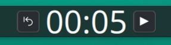
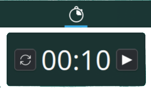
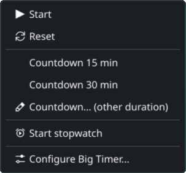
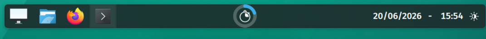
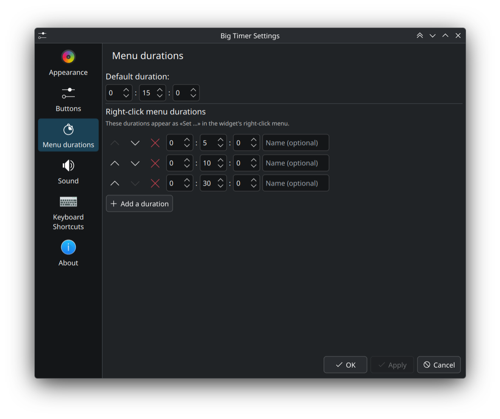

# Big Timer

A **KDE Plasma 6** countdown timer and stopwatch **with an adjustable font size** — born from
the fact that the built-in `org.kde.plasma.timer` has no font settings and its digits don't grow.
Here the font is driven explicitly, so the digits can be as big as you want on the desktop, and
the time fits the panel it sits in.



## Features

- **Countdown and stopwatch** in the same widget: pick a duration or start the stopwatch from
  the right-click menu, or by clicking the digits while stopped
- **Adjustable font** — size, family and color of the digits
- **Start / Pause / Reset**, clock-based (accurate, survives system sleep); Reset always goes
  back to the chosen duration (countdown) or to zero (stopwatch)
- **Right-click menu**: Start/Pause, Reset, your countdowns written in plain words
  (`Countdown 15 min`, `Countdown 1 h`), *Other duration…* for any duration, and
  *Start stopwatch*
- **Countdown editor**: a list of `hh:mm:ss` durations with optional names and reordering
- **Remembers** the mode and the last chosen duration
- **In a panel**: the time (sized to the panel), the icon with a progress ring or bar, or the
  icon while idle and the time once started — click to open the full timer
- **Buttons**: four layouts (Reset left / Start right, below, above, none), optional text,
  adjustable size, optional **+/−** buttons for the countdown
- **Warning color** near the end of a countdown (configurable threshold)
- **End of countdown**: the bundled beep (repeatable N times, or off) or a **custom sound**, plus
  an optional **desktop notification**
- **26 languages** (all official EU languages + Russian + Ukrainian)

## Screenshots

In a panel (the time, the default):


Click it to open the full timer (here with the "icon, then the time once started" panel choice):



Right-click menu:



Icon with progress (for thin panels):



Settings — panel:


Settings — countdown editor:



## Install

From Plasma: right-click the desktop or a panel → *Add Widgets* → *Get New…* →
*Download New Plasma Widgets* → search for **Big Timer**.

Or from the sources:

```bash
git clone https://github.com/Mirilindo/timer_widget.git
cd timer_widget
./install.sh
```

Then: right-click the desktop or a panel → *Add Widgets* → **Big Timer**.
Configure it with right-click → *Configure Big Timer*.

### Upgrading from 1.2 or earlier

Version 1.3 has a new widget ID (`io.github.mirilindo.bigtimer`), so Plasma sees it as a new
widget: remove the old Big Timer from your desktop or panel and add it
again. Most settings were reorganized, so the new one starts from the defaults.

## Translations

English and French are reviewed; the other languages are machine translations and may contain
mistakes. If you speak one of them, don't hesitate to contribute: open an
[issue](https://github.com/Mirilindo/timer_widget/issues) or a pull request with your
corrections. All the texts are in `package/contents/translations/strings.js`, one per line.

## Credits

- End sound: *[Beep 6](https://pixabay.com/sound-effects/beep-6-96243/)* by
  [freesound_community](https://pixabay.com/users/freesound_community-46691455/) via Pixabay
  (Pixabay Content License — free to use, no attribution required, credited here anyway).

## License

[GNU GPL v3](LICENSE) or later.

## Author

Mirilindo — <https://github.com/Mirilindo>

> Developed with the assistance of Claude (Anthropic).
