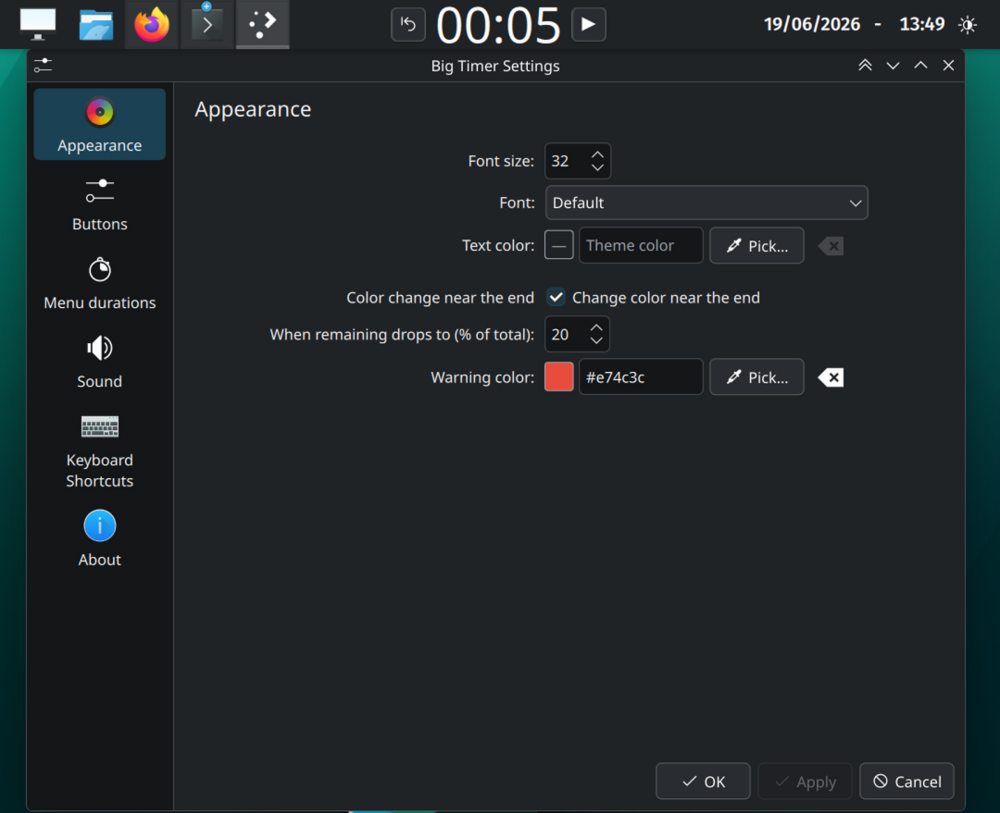

# Big Timer

A **KDE Plasma 6** countdown timer widget **with an adjustable font size** — born from the
fact that the built-in `org.kde.plasma.timer` has no font settings and its digits don't grow.
Here the font is driven explicitly, so the digits can be as big as you want, on the desktop or
in a panel.


## Features

- **Adjustable font** — size, family and text color of the digits
- **Start / Pause / Reset**, with a clock-based countdown (accurate, survives system sleep)
- **Buttons on any side** of the digits (left / right / top / bottom), each one hideable, with
  optional text label (icon-only possible)
- **Right-click menu**: Start, Reset, configurable preset durations shown as `Set hh:mm:ss [name]`,
  and a *Set a time…* dialog for any custom duration
- **Duration editor**: a clean list of `hh:mm:ss` durations with optional names and reordering
- **Warning color**: the digits change color when the remaining time drops below a configurable
  threshold (% of total)
- **End sound**: the bundled beep (repeatable N times, or off) or a **custom MP3**, plus an
  optional **desktop notification**
- **26 languages** (all official EU languages + Russian + Ukrainian)

## Screenshots

In a panel:


Settings:



## Install

```bash
git clone https://github.com/Mirilindo/timer_widget.git
cd timer_widget
./install.sh
```

Then: right-click the desktop or a panel → *Add Widgets* → **Big Timer**.
Configure it with right-click → *Configure Big Timer*.

## Translations

Most languages are reviewed; some of the rarer ones are machine translations and may need
refinement — contributions from native speakers are very welcome (see
`package/contents/translations/strings.js`).

## Credits

- End sound: *[Beep 6](https://pixabay.com/sound-effects/beep-6-96243/)* by
  [freesound_community](https://pixabay.com/users/freesound_community-46691455/) via Pixabay
  (Pixabay Content License — free to use, no attribution required, credited here anyway).

## License

[GNU GPL v3](LICENSE) or later.

## Author

Mirilindo — <https://github.com/Mirilindo>

> Developed with the assistance of Claude (Anthropic).
